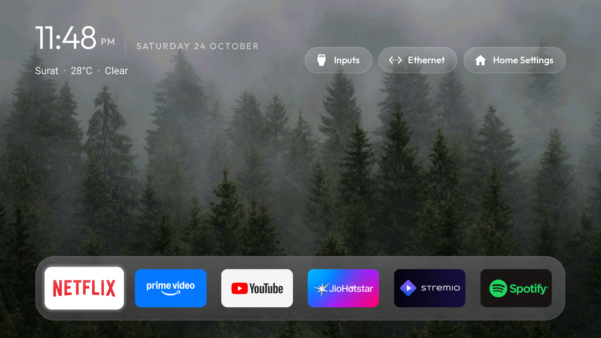
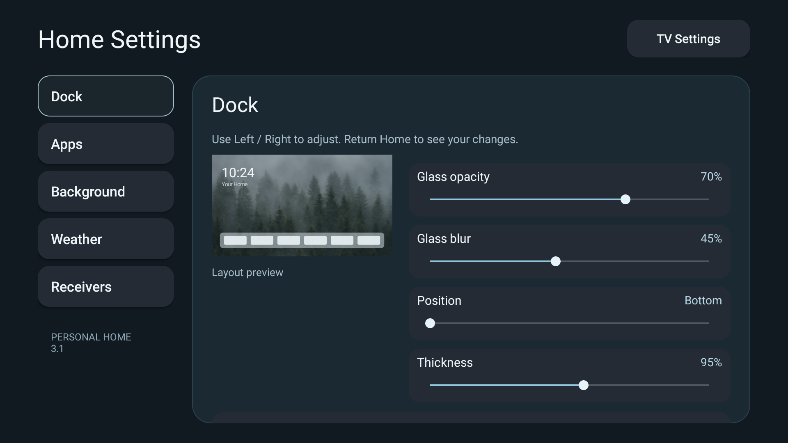

# Stillframe

A calm Android TV home screen with a glass dock, landscape wallpapers, weather and settings you can change from the remote. Built on [CleanYourTV](https://github.com/Gathin23/cleanyourtv), customised and tested on a Xiaomi Mi TV.

[Download Stillframe 1.0, build 11](https://github.com/prarthanagarwal/stillframe-tv/releases/tag/stillframe-v1.0-build11) · [Build from source](#build-from-source) · [AirPlay setup](airplay/README.md) · [Device setup and recovery](launcher/setup/README.md)



## Your Home, your choices

| Area | Controls |
|---|---|
| Apps | Choose and arrange up to seven dock apps; show or hide Home shortcuts |
| Dock | Independent thickness and vertical position, with a layout preview |
| Glass | Continuous opacity and blur sliders, both 0–100% |
| App grid | Normal 16:9 tiles; changing dock thickness does not squash the other apps |
| Background | Three bundled landscapes, your own picture through a file provider, dimming and optional rotation |
| Weather | City search, Celsius/Fahrenheit and a visibility toggle; Surat is the default |
| TV | Inputs, network and Home Settings on Home; TV Settings stays at the top right inside settings |
| Receivers | AirPlay settings shortcut, with the existing Chromecast receiver retained |
| Developer | Confirmed ADB switch and shortcuts to Android Developer options and native TV settings |
| Startup | Opens Stillframe after Android settles if this TV initially shows a signal input; can be turned off |

The initial dock is **Netflix, Prime Video, YouTube, JioHotstar, Stremio and Spotify**. There are no recommendation previews or sponsored content rows in Stillframe.

Hold **OK** on an app, choose **Add to dock**, then choose the place to replace. **Move** lets the arrows carry an app; OK/Back puts it down, and leaving arrangement mode saves it. The **Apps** section of Home Settings offers a dock picker and shortcut visibility controls.

## Dock settings on the TV



Use Left/Right on a slider and return Home to apply your changes. Dock thickness is 40–140% of normal tile height. Position runs from the bottom to the safe area below the header. **Reset dock appearance** restores the starting layout and glass settings.

The screenshots were captured directly from the MiTV-AXSO1 during the 3.1 predecessor. The same forest wallpaper and dock choices carry into Stillframe 1.0; the on-TV settings now show the Stillframe name and version.

The frosted dock is made from a small cached wallpaper sample, blurred off the main thread when the wallpaper changes or Home rebuilds. App navigation does not calculate blur on every frame. Weather uses [Open-Meteo](https://open-meteo.com/) over HTTPS, refreshes while Home is visible and keeps a labelled cache when needed. No analytics service was added.

## AirPlay, without replacing Chromecast

The separate [AirPlay Server](https://github.com/jqssun/android-airplay-server) receiver is installed and configured as **Mi TV AirPlay**, with start at boot and background operation. Its foreground service and Bonjour advertisement were verified on the TV. Open **Home Settings → Receivers → AirPlay settings** for its name, PIN and startup options.

This fork includes a pinned installer for the official **v0.0.33** APK, with SHA256 verification before installation:

```sh
python3 airplay/install.py --serial TV_IP:5555 --name "Mi TV AirPlay"
```

Then select **Mi TV AirPlay** in Screen Mirroring on an iPhone, iPad or Mac on the same network. End-to-end mirroring/audio remains an owner/device test. FairPlay-protected video from services such as Netflix, Apple TV+ and Disney+ is unsupported; use their installed TV apps for that content.

The receiver is a separate GPL-3 application. No GPL receiver code is mixed into this MIT launcher. See [AirPlay setup, source and verification](airplay/README.md).

## What we cleaned up

The TV originally had **124 Android packages**, including system services and drivers. That number was not 124 visible apps. After cleanup, 29 of the original packages had enabled TV app entries.

We disabled **14 selected packages**, preserving the ability to undo every package change. The targets cover Xiaomi analytics, PatchWall/web promotions, floating overlays, recommendation services, partner auto-install configuration and the old Google launcher. **Google Play Movies & TV** and **Xiaomi TV+** were also disabled at the owner's request.

All other original apps were retained, including streaming apps, Google Play Store/Services, Chromecast, voice search, keyboard, Bluetooth/remote services, firmware updates and TV/HDMI input services. No system packages were uninstalled, no root was used and no firmware was flashed.

The owner also enabled AdGuard Private DNS (`dns.adguard-dns.com`) and confirmed streaming playback still worked. This does not remove every advertisement inside streaming apps. See the [exact MiTV-AXSO1 cleanup list](launcher/setup/mi-tv-axso1-disabled.txt) and [setup/recovery notes](launcher/setup/README.md). Device backups, account data, network addresses, signing keys and private app settings are not published here.

## Developer controls

Home Settings includes a **Developer** page with the current ADB debugging state, a confirmed on/off switch, Android Developer options and native TV settings. The ADB switch requires the optional `WRITE_SECURE_SETTINGS` grant; this powerful Android permission is not granted by default. From `launcher/`, grant it during an install with `GRANT_ADB_CONTROL=1 ./build-and-install.sh TV_IP:5555`. Revoke it with `adb -s TV_IP:5555 shell pm revoke com.gathin.tvhome android.permission.WRITE_SECURE_SETTINGS`. The system shortcuts work without this grant. The launcher uses the permission for its ADB switch and optional accessibility-helper repair. Stillframe does not run a delayed launch after boot; the TV firmware controls whether it auto-plays a TV input at power-on.

## Install or update

The checked hardware is **MiTV-AXSO1 / dangalFHD**, Android 9 (SDK 28), firmware PI.6157, 32-bit ARM, with a 1080p display and about 2 GB RAM. This is the verified setup, not a compatibility claim for every TV.

1. Enable ADB on the TV and authorize your computer.
2. Download the APK from [Releases](https://github.com/prarthanagarwal/stillframe-tv/releases/tag/stillframe-v1.0-startup).
3. Install it over your existing Stillframe installation:

```sh
adb connect TV_IP:5555
adb -s TV_IP:5555 install -r Stillframe-v1.0-build10.apk
adb -s TV_IP:5555 shell am start -W -n com.gathin.tvhome/.MainActivity
```

To enable the Developer page's ADB switch, grant its optional permission once over ADB: `adb -s TV_IP:5555 shell pm grant com.gathin.tvhome android.permission.WRITE_SECURE_SETTINGS`. See [Developer controls](#developer-controls) for revoking it.

The retained `com.gathin.tvhome` identity preserves the Home assignment and saved preferences on our configured TV. A first-time installation still needs a verified Home handover. Some firmware keeps its original launcher at higher priority; do not disable the current Home until the new one actually starts and a recovery route is ready.

Updates must use the same signing key as the installed app. If an existing CleanYourTV build uses another key, rebuild with that key; do not uninstall the active Home to get around a signature mismatch. The release APK is the personal build used on this TV.

Turn debugging off and revoke ADB authorizations when finished. Our TV was intentionally left connected for ongoing customization.

## Build from source

Use **JDK 17**, Android SDK **platform 34**, **build-tools 34.0.0**, and platform-tools. Set `JAVA_HOME` and `ANDROID_HOME`:

```sh
git clone https://github.com/prarthanagarwal/stillframe-tv.git
cd stillframe-tv/launcher
./gradlew --no-daemon testReleaseUnitTest lintRelease assembleRelease
```

APK output: `launcher/app/build/outputs/apk/release/app-release.apk` from the repository root.

The portable installer builds, starts the app and verifies Home resolution. It does not disable another launcher:

```sh
cd launcher
TV_SERIAL=TV_IP:5555 ./build-and-install.sh
```

The launcher includes local photographs, so its roughly 2.7 MB APK intentionally exceeds the upstream minimal launcher's 512 KB target. No web runtime or heavy UI framework was added.

### Validation

- **236 launcher unit tests passed**; Android lint reported **zero errors**.
- Stillframe 1.0 build 11 is installed on the TV, Home remains assigned, and firmware input auto-play is disabled so Android can open Stillframe directly.
- Real TV captures verify Home and the Dock settings screen shown above.
- Both requested app removals are disabled; the total disabled package count is 14.
- AirPlay's foreground service and Bonjour advertisement were verified.
- Three AirPlay installer smoke tests cover integrity verification, shell-safe receiver names and the pinned release.
- Further physical remote/settings and end-to-end mirroring checks are left to the owner.

## Repository map

| Path | Purpose |
|---|---|
| [`launcher/`](launcher/) | Stillframe native Android app, custom settings, defaults and JVM tests |
| [`launcher/README.md`](launcher/README.md) | Controls, build details and source map |
| [`airplay/`](airplay/) | Separate receiver installer, documentation and smoke tests |
| [`launcher/setup/`](launcher/setup/) | Tested device cleanup, DNS, AirPlay and recovery record |
| [`docs/images/`](docs/images/) | The real TV screenshots used in this README |
| [`tools/`](tools/) | Original guarded CleanYourTV device and restore tools |
| [`examples/`](examples/) | Upstream community device references; inspect your own TV before using a list |
| [`README.upstream.md`](README.upstream.md) | Original CleanYourTV README retained for reference |

The launcher source is under `launcher/app/src/main/java/com/gathin/tvhome/`. The most relevant files are `LauncherSettingsActivity`, `AppAdapter`, `DockLayout`, `DockDecoration`, `PixelBlur`, `HomePreferences`, `WeatherLine` and `MainActivity`.

## Credits and licences

- [CleanYourTV by Gathin](https://github.com/Gathin23/cleanyourtv): the launcher foundation, guarded debloat tools, community device knowledge and MIT licence.
- [CleanYourTV UI by Matheus Caldeira](https://github.com/matheus-caldeira/cleanyourtv-ui): inspiration for the slimmer glass dock and on-TV settings direction.
- [nguyenduchoai's AirPlay branch](https://github.com/nguyenduchoai/tv-vibehack/tree/feat/airplay-receiver): companion receiver setup reference.
- [jqssun/android-airplay-server](https://github.com/jqssun/android-airplay-server) and [UxPlay](https://github.com/FDH2/UxPlay): separate GPL-3 AirPlay receiver and protocol core.
- [CleanFrame](https://github.com/nthnclrk/CleanFrame): source/provenance for the selected landscape assets; no CleanFrame app code is used.
- Landscape photographers Aniket Deole, Dejan Zakic and John Rodenn Castillo: [individual credits and source pages](launcher/WALLPAPER-CREDITS.json), under the Unsplash License.
- Open-Meteo weather data: CC BY 4.0. Outfit font: SIL Open Font License.

See [LICENSE](LICENSE), [third-party notices](launcher/THIRD-PARTY-NOTICES.md), [font licence](launcher/FONT-LICENSE-OFL.txt) and [wallpaper credits](launcher/WALLPAPER-CREDITS.json). Service logos identify the installed apps and remain their owners' trademarks. This project is independent of Xiaomi, Google, Apple and the streaming services.
